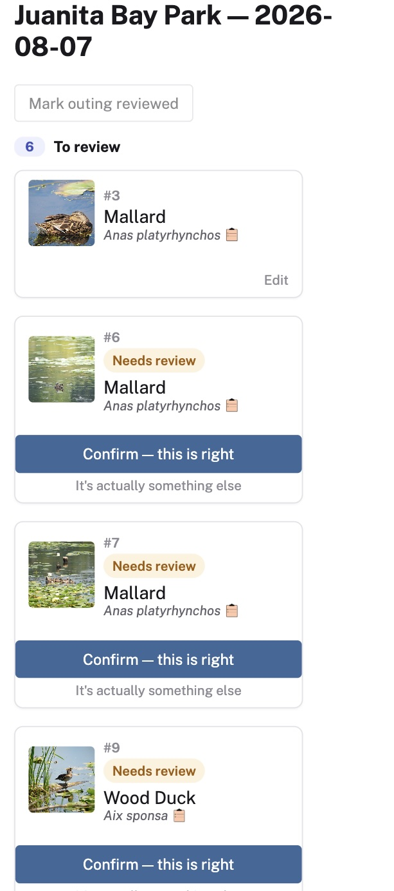

# Pictala

**What's actually in your bird photos.**

Pictala matches your eBird checklists to your Flickr photos, outing by outing, so you can see which bird is in
which picture, with its common and scientific name.

Work is tracked on the [issues board](https://github.com/JennSW/Pictala/issues). Where this README refers to an
issue, it gives the issue's title.

*Formerly BirdTrip. A name conflict with an existing app forced the rename; the story is in
[`docs/NAMING_REVIEW.md`](docs/NAMING_REVIEW.md). Older documents still use the old name.*

I built it as a portfolio project: a real program, planned and run start to finish, with the working documents
kept. It is also a tool I use on my own outings. The full story is on
[my site](https://theswiftbrain.com/pictala-story).

<p>
  
  
</p>

*Left: an outing mid-review, with matches awaiting confirmation and photos still needing an identification.
Right: the same flow at phone width.*

## The problem

Bird photographers keep two disconnected records of the same outing: an **eBird checklist** (what you saw) and a
**photo host** (what you photographed). Nothing links them. Answering "what did I actually photograph on this
walk?" meant cross-referencing both by hand, every time.

## How it works

1. Import your eBird history (a CSV you download from eBird).
2. Sync your Flickr photos for the same dates.
3. Match each photo to the outing it was taken on, then to the species it shows.
4. Review the results outing by outing.

**Rules first, AI only where it earns its place.** Time-window matching (plus location, when a photo has GPS) handles most photos
deterministically, and a photo whose title or tags name a species on the checklist is matched to it without any
model call. Only photos the rules can't identify get an AI suggestion, and nothing is accepted silently: every
match is a suggestion you confirm, correct, or set aside. The reasoning, and what I'd say if asked "where's the
AI?", is in [`docs/DESIGN.md`](docs/DESIGN.md) (sections 4 and 9).

**Why the name.** *Pictala* is *pictura* ("picture") plus *ala* ("wing"): picture-wing.

## Built with

Python 3.12, FastAPI, SQLAlchemy and SQLite on the backend; React, TypeScript and Vite on the front. Photos come
from Flickr's REST API (OAuth 1.0a), checklists from eBird's own CSV export, and optional species suggestions from
the Anthropic API. It runs locally, for one user, by design.

I built it with Claude Code as a pairing partner. It wrote code; the scoping calls, tradeoffs, and what counts as
"done" were mine, and the decisions below show where.

## Decision log

The five session recaps below are where the real decisions were made, with the reasoning at the time.

| When | What was decided |
|---|---|
| [2026-07-27](docs/Read%20Me/README-2026-07-27-1152.md) | **Write the PRD first.** Noticing the work had started "from the middle", I stopped to write down why the app exists. A sync story that had grown into a spec was split into one functional spec plus three small stories. Portfolio first, personal tool second. |
| [2026-07-28](docs/Read%20Me/README-2026-07-28-1318.md) | **Hybrid matching.** Checklist first; AI only as a fallback. The deciding factor was that the AI's role should read as a deliberate, narrow engineering decision, not a checkbox. |
| [2026-08-05](docs/Read%20Me/README-2026-08-05-1153.md) | **Knowing when to stop.** One issue closed by finding the camera has no GPS (1 of 594 photos has coordinates), one closed with no code, and a duplicate-detection heuristic stopped, not shipped, when real data showed it flagged 499 of 594 photos. A working rule followed the next day. |
| [2026-08-11](docs/Read%20Me/README-2026-08-11-1633.md) | **Deciding what MVP is.** "I have allowed scope creep." The board was checked against the original PRD and split into MVP and V2. It also found an accessibility requirement in the PRD with no tracking issue at all. |
| [2026-09-19](docs/Read%20Me/README-2026-09-19-1328.md) | **Dependencies and a data-loss find.** Hosting turned out to be a third blocking decision for multi-user. Work was sequenced by backend coupling. An estimate marked "quick" was corrected before starting. A data-loss defect was filed (fixed since, see below). |

## Engineering practice

- **114 automated backend tests.** Recent fixes ship with regression tests, such as the data-loss defect found on
  2026-09-19 (the issue "Defect: eBird CSV re-import silently wipes previously-confirmed species matches", fixed
  2026-10-13). Coverage has known gaps, documented in the issue "Chore: add unit tests for untested service-layer
  modules".
- **A GitHub project board with 95 issues**, 74 closed. Defects, scope decisions, and "decide, don't build" items
  are all tracked.
- **Review passes on the code and docs:** a full-history audit,
  [`docs/CODE_REVIEW_2026-09-04.md`](docs/CODE_REVIEW_2026-09-04.md), and two code-quality reviews from
  [2026-09-04](docs/CODE_QUALITY_REVIEW_2026-09-04.md) and
  [2026-09-14](docs/CODE_QUALITY_REVIEW_2026-09-14.md).
- **A real naming process**: 151 candidate names reviewed, with trademark, domain and app-store checks (not a
  formal legal clearance). See [`docs/NAMING_REVIEW.md`](docs/NAMING_REVIEW.md).

## Documents

| | |
|---|---|
| [`docs/PRD.md`](docs/PRD.md) | What and why: goals, scope, audience |
| [`docs/DESIGN.md`](docs/DESIGN.md) | Architecture and the rules-versus-AI tradeoff |
| [`docs/USER_STORIES.md`](docs/USER_STORIES.md) | Stories with acceptance criteria |
| [`docs/PROGRAM_CHARTER.md`](docs/PROGRAM_CHARTER.md), [`docs/STATUS_REPORT_2026-08-30.md`](docs/STATUS_REPORT_2026-08-30.md), [`docs/MULTI_USER_AUTH_SCOPING.md`](docs/MULTI_USER_AUTH_SCOPING.md) | The program-management set for the multi-user phase |
| [`docs/COMPETITIVE_LANDSCAPE.md`](docs/COMPETITIVE_LANDSCAPE.md), [`docs/BACKLOG_SCOPING.md`](docs/BACKLOG_SCOPING.md) | Existing tools; how the backlog was ordered |
| [`docs/API_DOCUMENTATION.md`](docs/API_DOCUMENTATION.md), [`docs/diagrams/`](docs/diagrams/) | API reference; data-model and flow diagrams |
| [`docs/mockups/`](docs/mockups/) | Wireframes |

## Run it

```bash
./start.sh
```

This sets up a private Python environment, installs the front end, loads **synthetic sample data** (14 invented
outings, no real person's data, and only into an empty database), and opens the app. For manual setup, credentials, and details, see
[`docs/QUICKSTART.md`](docs/QUICKSTART.md).

**Platforms:** designed and built on a MacBook, and tested only there. It should also run on a Windows or Linux PC,
but **no testing has been done on any platform other than a MacBook**. `start.sh` is written for macOS; on a PC,
follow the manual setup in the QUICKSTART.

**What you'll need.** The sample data runs with nothing else. To use your own data you need accounts and keys:

| What | Used for | Required? |
|---|---|---|
| **eBird CSV** (your "Download My Data" export; not a key) | Your checklists | Yes, for your own data |
| **Flickr app key and secret**, plus a one-time authorization | Your photos | Yes, for photos |
| **eBird API key** (free, instant: https://ebird.org/api/keygen) | Looking up a species you type, or one the AI suggests, that isn't on the checklist | Only for those lookups; everything else works without it |
| **Anthropic API key** | AI species suggestions | Optional |

Keys go in `backend/.env` (copy `backend/.env.example`). Without Flickr you will see outings and species but **no
photos**, because photos arrive only through a Flickr sync. Without an Anthropic key you pick species by hand. A
no-credentials demo with sample photos is not part of v1. Step by step, plus what each error message means, is in
[`docs/QUICKSTART.md`](docs/QUICKSTART.md).

## What "done" means here

The PRD's own success criteria were a portfolio piece that holds up under technical questioning, can be walked
through end to end, and has wireframes, plus a tool that is useful on real outings. By that measure **v1 is
done**: the scoped features ship, the open items are documented rather than hidden, and the reasoning is in the
documents above. Further work is on the product track, at the pace I have time for.

## Known limitations and what's next

- **Single user, local only, by design.** There is no hosted version.
- **You need your own accounts.** eBird has no personal-data API, so checklists come from a CSV you upload
  yourself; Flickr needs your own app key.
- **No client-side routing**: reloading the page loses your place (issue: "No client-side routing -- browser back /
  reload loses all navigation state").
- **Shared eBird checklists** show only the owner's version (issue: "Shared/group checklists: default to owner's
  own list, surface links to other participants' versions").
- **Photos with no capture date** take their date from the title when it starts with one ("October 7 2026");
  titles without a leading date aren't recovered.

**Product track (not v1)**, each tracked as an issue on the board:

- A no-account demo mode with sample photos, deliberately left out of v1.
- Multi-user support, blocked on three decisions (how accounts are created, SQLite versus Postgres, and hosting):
  "V2: Multi-user support (Flickr + Merlin user IDs)".
- Sharing with other birders: "V2: Share BirdTrip with the birding community".
- Other photo hosts: "V2: Additional photo hosting sites (e.g. SmugMug)".
- Merlin recordings: "V2: Merlin recordings".
- Writing species back to Flickr: "Investigate writing species ID back to Flickr (title/description)" and
  "V3: Post to Flickr for missing matches".
- A location map: "V3: Map of location".

## A note on this repository's history

This repository's history was rewritten before it was made public. Earlier history documentation
(session logs and sample data) included personal information and was deleted for privacy reasons.
Two consequences are worth knowing. First, the commit history is shorter than the work it describes:
the full set of session logs is not here, which is why the decision log above links a curated five.
Second, commit hashes quoted in older discussions will not match.

## License

The code is licensed under the [PolyForm Noncommercial License 1.0.0](LICENSE). It is **source-available, not open
source**: you are free to read it, run it, and modify it for personal, hobby, research, educational and other
noncommercial use. **Commercial use requires my permission.** If you want to build on Pictala commercially,
contact me at jenswift@duck.com.

Any of my photographs that appear in this repository (for example in screenshots) are all rights reserved. They are
not covered by the code license and may not be reused in other works.

I'm not accepting outside contributions to this repository at this time.
